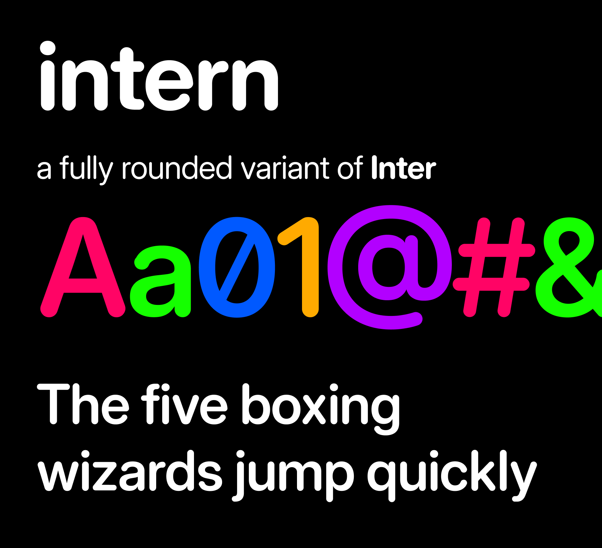

# Intern

Intern is a fully rounded variant of [Inter](https://rsms.me/inter/) by [Rasmus Andersson](https://rsms.me/).



## Web

```css
@font-face {
  font-family: "Intern";
  src: url("Intern[opsz,wght].woff2") format("woff2");
  font-weight: 100 900;
  font-style: normal;
  font-display: swap;
}
```

## Coverage

Latin, including Vietnamese, plus digits, punctuation, currency and common math symbols. There
is no Greek, Cyrillic or italic yet.

## License

[SIL Open Font License 1.1](OFL.txt).
